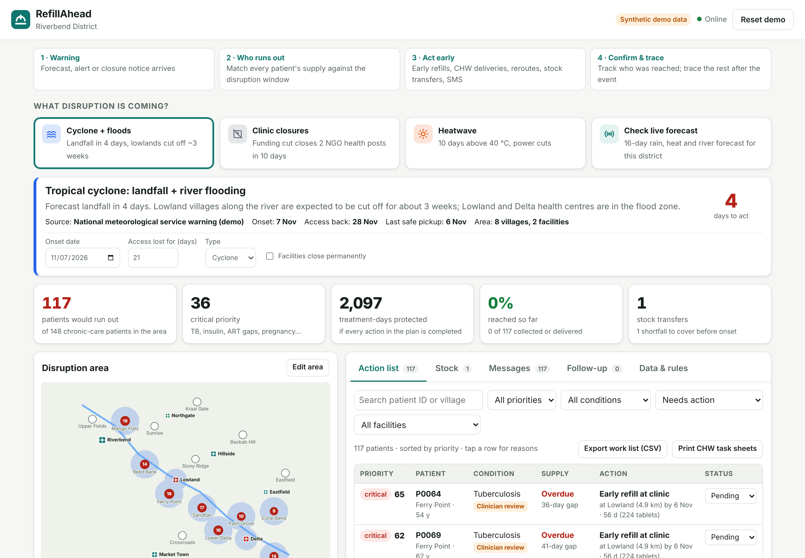
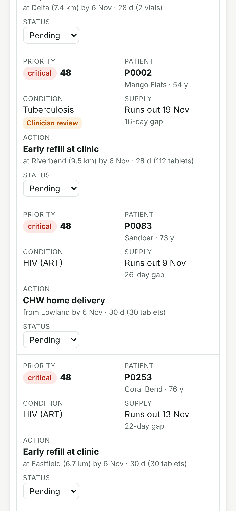

# RefillAhead

**Get chronic-care patients their medicine *before* a flood, cyclone, heatwave or clinic closure cuts them off.**

Entry for the **MIT Solve 2027 Global Health Challenge**, dimension *"Strengthen continuity of care in the face of outbreaks, climate shocks, conflicts or financing disruptions."*



## The problem in one paragraph

Most disruptions to care are announced in advance. A cyclone warning comes days ahead. A flood forecast comes a week ahead. A donor stop-work order comes weeks ahead. Clinics already know who is on HIV, TB, diabetes, hypertension or epilepsy treatment and when each person's medicine runs out. Nobody joins the two in time, so patients run out exactly when roads flood or clinics close. The evidence (Pakistan 2022, Cyclone Idai, the 2025 aid cuts) is in [research/RESEARCH.md](research/RESEARCH.md).

## What the prototype does

1. **Warning.** Pick a disruption (cyclone, clinic closure, heatwave), run a **live forecast check** (Open-Meteo rain, heat and river discharge), or click villages and facilities on the map to define your own.
2. **Who runs out.** Every patient's run-out date is compared with "access returns + safety buffer".
3. **Act early.** For each patient it picks the cheapest safe action: early refill, community health worker (CHW) delivery, or reroute + bridging supply. Supply is capped by editable, WHO-aligned rules, with clinician-review flags. Patients are ranked by a transparent priority score that lists its reasons.
4. **Stock.** It adds the plan's demand to each facility's routine reserve, proposes transfers to cover shortfalls, and flags stock sitting in flood-zone or closing facilities.
5. **Messages.** SMS / voice / in-person scripts in English, Portuguese, Kiswahili and French. They **never name the condition or medicine**. There is a CSV export for any SMS gateway.
6. **Confirm & trace.** It tracks who collected. After the deadline, a tracing list is produced, plus printable CHW task sheets per village.

It works **offline** (installable PWA, no server, no map tiles), imports **CSV patient line lists**, and keeps all data in the browser.

> All demo names, patients and stock levels are **synthetic**. Clinical rules are defaults to be validated against national guidelines. The live forecast is not an official warning.

<p align="center"></p>

## Run it

No build step and no dependencies.

```bash
npm run serve
```

Then open http://localhost:8080. Any static file server pointed at `prototype/` also works.

## Test it

```bash
npm test
```

That runs 26 unit tests: planning engine, stock planner, forecast triggers, CSV import/export, message privacy and SMS length.

```bash
npm run e2e
```

That runs 16 browser checks in headless Chromium, including the mobile layout. It needs Playwright installed (`npm i -g playwright && npx playwright install chromium`).

## Publish the demo (for the Solve application's website field)

1. Merge this branch into `main`.
2. In the repository: **Settings → Pages → Source: GitHub Actions**.
3. The *Deploy demo to GitHub Pages* workflow publishes `prototype/` to `https://<your-username>.github.io/mitsolve/`. You can also run it by hand from the **Actions** tab.
4. Open the URL on your phone before you paste it into the application.

## Repository layout

```
prototype/            the app (static files, open index.html via any web server)
  src/engine.js       planning engine: exposure, supply gap, actions, priority, stock, follow-up
  src/scenario.js     synthetic demo district + preset events
  src/forecast.js     Open-Meteo live triggers (rain, heat, river rise)
  src/messages.js     condition-neutral, multilingual SMS templates
  src/csv.js          CSV import/export with validation
  src/map.js          offline SVG map
  src/app.js          UI
  tests/              node:test unit tests
  e2e/                static server + Playwright smoke test
research/RESEARCH.md  MIT Solve research: deadlines, winners, options, evidence, landscape, sources
application/APPLICATION_DRAFT.md  draft answers mapped to the Solve form + 3-day plan + video script
```

## Status

**Prototype.**
- Built: the planning engine, the offline web app, the three scenarios, the live forecast check, CSV import/export and the editable rules.
- Not built yet: EMR connectors (FHIR / DHIS2 / OpenMRS), SMS gateway integration, user accounts, encryption at rest, the planned interruption-risk model, and native-speaker review of the translations.

## License

MIT
